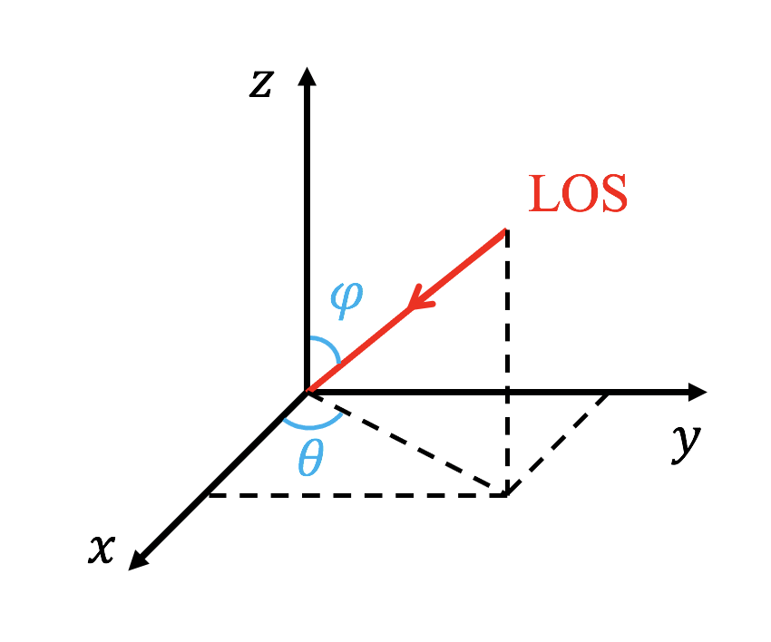

title: Setting parameters

# Introduction {: #par_intro }
This document describes the usage of a `.par` parameter (input) file for AGILE.
For a list of command line options, see [Command line parameters](commandline.html).

Parameters are grouped in namelists according to their functionalities. The namelists
have physics-independent class and physics-dependent class. The physics-independent class includes:

* [filelist](#par_filelist) Name and type of files to save (or read)
* [savelist](#par_savelist) When to save data
* [stoplist](#par_stoplist) When to stop the simulation
* [methodlist](#par_methodlist) Which numerical methods to use (e.g., flux scheme, time stepper, time integrator, limiter)
* [boundlist](#par_boundlist) Boundary conditions
* [meshlist](#par_meshlist) Mesh-related settings (e.g. domain size, refinement)
* [paramlist](#par_paramlist) Time-step parameters

The default parameter values in these namelists are set in
`src/io/mod_input_output.fpp`, look at the subroutine `read_par_files` for
details.

The physics-dependent namelists are those of the four physics modules; only
the one matching `phys` in `&methodlist` is read:

* [hd_list](#par_hdlist) (see `src/hd/mod_hd_templates.fpp`)
* [mhd_list](#par_mhdlist) (see `src/mhd/mod_mhd_templates.fpp`)
* [ffhd_list](#par_ffhdlist) (see `src/ffhd/mod_ffhd_templates.fpp`)
* [srhd_list](#par_srhdlist) (see `src/srhd/mod_srhd_templates.fpp`)

Further namelists control optional modules. They are not documented here, but
the parameters are described in the corresponding modules:

* `rc_list` (radiative cooling, read when `*_radiative_cooling` is on; see
  [Radiative cooling](radiative_cooling.html) and `mod_radiative_cooling`)
* `bd_list` (boundary data read from file, see `mod_bc_data`). It is still
  read, but the `'bc_data'` boundary type it serves does not work, see
  [typeboundary](#par_typeboundary)
* `rh_list` (random heating, for a case that calls it from its `mod_usr`;
  see `mod_random_heating`)

## An example for a namelist

The parameter file consists of a sequence of namelists, which look like this:

```fortran
&listname
 var_a = value

 ! A comment
 var_b = value
 array = value1, value2, ...
 array(1,1) = value

 ! Repeat value 5 times in array
 array = 5*value
 ...
/
```

If you do not define a variable the default value is used. 

The Fortran 90 standard for logical variable values is either `T` and `F` or
`.true.` and `.false.`, but some compilers accept only one of them. Text between
namelists is ignored, but it may result in a run time error on some
machines/compilers.

The following namelist examples contain all the possible variables to set,
choices are indicated by `|`. The first choice is the default value. Only the
parameters different from default need to be set. Names that should be replaced
are in capital letters. The `...` indicates optional extra elements for arrays,
or extra words in strings.

# Physics-independent Namelists {: #par_pidnamelists }
## filelist {: #par_filelist }
```fortran
&filelist
 base_filename= 'data' | CHARACTER                       ! prefix of every output file
 restart_from_file= undefined | CHARACTER                ! snapshot to restart from
 snapshotnext= -1 | INTEGER                              ! -1: continue the numbering
 slicenext= -1 | INTEGER
 collapsenext= -1 | INTEGER
 firstprocess= F | T
 reset_grid= F | T
 typefilelog= 'default' | 'regression_test' | 'special'
 convert= F | T
 autoconvert= F | T
 convert_type= 'vtuBCCmpi' | 'vtuBmpi' | 'vtuCCmpi' | 'vtumpi' | 'vtuBCC' | 'vtuB' | 'vtuCC' | 'vtu' | 'vtuBCCmpi64' | 'vtuBmpi64' | 'vtuBCC64' | 'vtuB64' | 'pvtuBCCmpi' | 'pvtuBmpi' | 'pvtuCCmpi' | 'pvtumpi' | 'vtiCCmpi' | 'vtimpi' | 'tecplotCCmpi' | 'tecplotmpi' | 'tecplotCC' | 'tecplot' | 'onegrid' | 'oneblock' | 'oneblockB' | 'user' | 'usermpi' | 'EIvtiCCmpi' | 'ESvtiCCmpi' | 'SIvtiCCmpi' | 'WIvtiCCmpi' | 'EIvtuCCmpi' | 'ESvtuCCmpi' | 'SIvtuCCmpi' | 'WIvtuCCmpi'
 slice_type= 'vtuCC' | 'vtu' | 'csv' | 'dat'
 collapse_type= 'vti' | 'csv'
 saveprim= F | T
 nwauxio= 0 | INTEGER
 nocartesian= F | T
 w_write= nw*T | F
 writelevel= nlevelshi*T | F
 writespshift(1:ndim,1:2)= 0 | DOUBLE in [0,1)
 level_io= -1 | INTEGER
 level_io_min= 1 | INTEGER
 level_io_max= nlevelshi | INTEGER
 time_convert_factor= 1 | DOUBLE
 length_convert_factor= 1 | DOUBLE
 w_convert_factor= nw*1 | DOUBLE
 type_endian= 1 | INTEGER                                ! collapsed views only: 1 little-endian
 usr_filename= '' | CHARACTER                            ! VTK file a case can sample
/
```

### Output names, restarts and numbering {: #par_filelist_restart }
Every output file starts with `base_filename`, which may contain a
directory (`'output/kh3d'`); the run stops at startup if that directory is
not writable. Snapshots are `base_filename0000.dat`, `0001.dat`, ..., and the
log is `base_filename.log`. When several par files are given (`-i a.par
b.par`), each one's `base_filename` is appended to the previous one's if it
differs.

`restart_from_file` (or `-if` on the command line, which takes precedence;
see [Command line](commandline.html)) restarts from that snapshot; `-resume`
picks the newest snapshot under `base_filename` instead. A restart continues
the snapshot, slice and collapsed-view numbering where the run left off,
unless `snapshotnext`, `slicenext` or `collapsenext` give the next index
explicitly. A new run starts all three at 0. On a restart:

- `firstprocess = T` calls the case's `usr_init_one_grid` on every block
  again, to modify the restarted state, and then its
  `usr_improve_initial_condition` if that is registered. It needs a restart.
- `reset_grid = T` rebuilds the AMR tree from the restarted data instead of
  keeping the snapshot's mesh.

`usr_filename` names a VTK structured-points file that is read at startup;
a case's `mod_usr` can then sample it, for example for an initial condition,
through `read_data_get_3d` in `mod_init_datafromfile`.

### The log file {: #par_filelog }
`typefilelog = 'default'` writes one line per log output with `it`,
`global_time` and `dt`, the volume average of every conserved variable (so
that conservation can be checked when the boundaries allow it), the fraction
of the domain covered by each level and the number of blocks on each level,
followed by load balance, cell updates per second per core, active blocks
per core, wall-clock time per code time unit and the estimated time to
finish. A new run replaces an existing log; a restart appends to it.

`'regression_test'` writes the time and the means of `w` and `w**2`, which
is what the test suite compares (see `tests/test_rules.make`); `'special'`
calls the case's `usr_print_log` instead.

### Converting snapshots {: #par_convert }
The `.dat` snapshots are the only files a run can restart from. They can be
converted to other formats, either afterwards or during the run:

- `convert = T` (or `-convert` on the command line) together with
  `restart_from_file` converts that snapshot and exits without running; a
  new run with `convert = T` is refused. The types whose name contains `mpi`
  convert in parallel, the others need a single rank.
- `autoconvert = T` converts every snapshot as it is written.

`convert_type` selects the format. The `vtu*` types are unstructured VTK for
ParaView or VisIt: `CC` stores the cell-centre values (without it the values
are interpolated to the cell corners), `B` writes binary instead of ASCII (`64` with 64-bit floats), and
`pvtu*` writes one file per rank plus a header. `vtiCCmpi`/`vtimpi` are VTK
image data, the `tecplot*` types Tecplot files, and `'user'`/`'usermpi'` call
the case's `usr_special_convert`. The test suite uses the default,
`'vtuBCCmpi'`; the other formats are inherited from upstream and not
regularly exercised. The synthetic-emission types (`EIvtiCCmpi`, ...) are
described under [emissionlist](#par_emissionlist).

What is written:

- `saveprim = T` writes primitive instead of conserved variables.
- `nwauxio` extra variables can be added to the converted output, computed by
  the case's `usr_aux_output` and named by `usr_add_aux_names` (see
  [Auxiliary variables](mpiamrvac_nw.html)).
- In a spherical or cylindrical run the output is converted to Cartesian
  coordinates and vector components, unless `nocartesian = T`.
- `time_convert_factor`, `length_convert_factor` and `w_convert_factor`
  multiply the time, the coordinates and each variable, to write physical
  instead of code units.
- `w_write` and `writelevel` select the variables and levels written,
  `writespshift(idim,1:2)` clips the given fraction of the domain off its lower
  and upper side in each direction (only blocks entirely inside are kept).
- `level_io` resamples the whole mesh to that single level, and
  `level_io_min`/`level_io_max` bound the levels written. They act only in
  `convert` mode, not with `autoconvert`.

`slice_type` and `collapse_type` select the format of the [slices](slices.html)
and [collapsed views](collapsed.html); `type_endian` sets the byte order of
binary collapsed views (1, the default, is little-endian).

## savelist {: #par_savelist }
```fortran
&savelist
 itsave(SAVEINDEX,FILEINDEX)= biginteger | INTEGER  ! save at these steps
 tsave(SAVEINDEX,FILEINDEX)= bigdouble | DOUBLE     ! save at these times
 dtsave(FILEINDEX)= bigdouble | DOUBLE              ! save every dtsave in time
 ditsave(FILEINDEX)= biginteger | INTEGER           ! save every ditsave steps
 tsavestart(FILEINDEX)= 0 | DOUBLE                  ! dtsave saves start here
 tsave_log= 100*bigdouble | DOUBLEs                 ! = tsave(:,1)
 dtsave_log= bigdouble | DOUBLE                     ! = dtsave(1)
 ditsave_log= biginteger | INTEGER                  ! = ditsave(1)
 tsavestart_log= 0 | DOUBLE                         ! = tsavestart(1)
 tsave_dat= 100*bigdouble | DOUBLEs                 ! = tsave(:,2)
 dtsave_dat= bigdouble | DOUBLE                     ! = dtsave(2)
 ditsave_dat= biginteger | INTEGER                  ! = ditsave(2)
 tsavestart_dat= 0 | DOUBLE                         ! = tsavestart(2)
 tsave_slice= 100*bigdouble | DOUBLEs               ! = tsave(:,3)
 dtsave_slice= bigdouble | DOUBLE                   ! = dtsave(3)
 ditsave_slice= biginteger | INTEGER                ! = ditsave(3)
 tsavestart_slice= 0 | DOUBLE                       ! = tsavestart(3)
 tsave_collapsed= 100*bigdouble | DOUBLEs           ! = tsave(:,4)
 dtsave_collapsed= bigdouble | DOUBLE               ! = dtsave(4)
 ditsave_collapsed= biginteger | INTEGER            ! = ditsave(4)
 tsavestart_collapsed= 0 | DOUBLE                   ! = tsavestart(4)
 tsave_custom= 100*bigdouble | DOUBLEs              ! = tsave(:,5)
 dtsave_custom= bigdouble | DOUBLE                  ! = dtsave(5)
 ditsave_custom= biginteger | INTEGER               ! = ditsave(5)
 tsavestart_custom= 0 | DOUBLE                      ! = tsavestart(5)
 nslices= 0 | INTEGER
 slicedir= nslices INTEGERs from 1 to 3
 slicecoord= nslices DOUBLEs                        ! physical coordinates
 collapse= 3*F | T                                  ! one per direction
 collapseLevel= 1 | INTEGER
 time_between_print= 30 | DOUBLE                    ! seconds
/
```

AGILE writes five types of output, numbered by FILEINDEX:

index | output | named keys
---|---|---
1 | log file (`base_filename.log`), see `typefilelog` in [filelist](#par_filelist) | `*_log`
2 | snapshot (`.dat`), and its conversion if `autoconvert` is on | `*_dat`
3 | slices, see [Slice output](slices.html) | `*_slice`
4 | collapsed (line-of-sight integrated) views, see [Looking at line-integrated quantities](collapsed.html) | `*_collapsed`
5 | the case's `usr_write_analysis`, see [Writing a custom analysis subroutine](analysis.html) | `*_custom`

For each type, four triggers can be combined, and an output is written at a
step if any of them fires:

- `itsave(n,FILEINDEX)`: at step number `itsave(n,...)`, for `n` = 1 to 100.
  `itsave(1,FILEINDEX) = 0` writes the initial state; nothing else does,
  since a new run counts its start as the last save.
- `tsave(n,FILEINDEX)`: at time `tsave(n,...)`, up to 100 entries in
  increasing order. The time step is shortened to land on each of them.
- `dtsave(FILEINDEX)`: every `dtsave` in time, from `tsavestart` on. The time
  step is shortened to land on the multiples of `dtsave`.
- `ditsave(FILEINDEX)`: every `ditsave` steps.

The named keys are the same settings per type: `dtsave_dat = 0.1d0` is
`dtsave(2) = 0.1d0`, `tsave_log` fills `tsave(:,1)`, and so on; there are
`tsave_*`, `dtsave_*`, `ditsave_*` and `tsavestart_*` for each of `log`, `dat`,
`slice`, `collapsed` and `custom` (but no `itsave_*`). A named key, when set,
overrides the indexed form.

```fortran
&savelist
 itsave(1,1)= 0          ! log and snapshot of the initial state
 itsave(1,2)= 0
 dtsave_log= 0.01d0
 tsave_dat= 0.1d0, 0.25d0
 dtsave_dat= 0.5d0       ! snapshots at 0, 0.1, 0.25, 0.5, 1, 1.5, ...
 dtsave_slice= 0.05d0
/
```

Whatever ends the run, every type not already written at the last step is
written then (see [stoplist](#par_stoplist)), so a type with no trigger at
all still gets one output, at the end. A snapshot can also be forced at any
time by creating a file called `savenow` in the run directory; it is written
(together with the log) at the next step and the file deleted.

`nslices`, `slicedir` and `slicecoord` define up to 1000 slices, each a plane
normal to direction `slicedir` at the physical coordinate `slicecoord`; see
[Slice output](slices.html). `collapse(idim) = T` integrates the solution
along direction `idim` at refinement level `collapseLevel`; see [Looking at
line-integrated quantities](collapsed.html).

`time_between_print` is the wall-clock interval, in seconds, at which the
step number, time and time step are printed to the terminal.

## stoplist {: #par_stoplist }
```fortran
&stoplist
 time_max= bigdouble | DOUBLE            ! set at least one of time_max, it_max
 it_max= biginteger | INTEGER
 wall_time_max= bigdouble | DOUBLE       ! hours
 final_dt_reduction= T | F
 dtmin= 1.0d-10 | DOUBLE                 ! warns only, see below
 time_init= 0 | DOUBLE
 it_init= 0 | INTEGER
 reset_time= F | T
 reset_it= F | T
/
```

### time_max, it_max, wall_time_max {: #par_stop_limits }
The run ends at the start of the first step at which the time has reached
`time_max`, the step counter has reached `it_max`, or the wall-clock time is
about to pass `wall_time_max` (given in hours). If neither `time_max` nor
`it_max` is set, a warning is printed and the run continues until another
limit stops it. Whatever ends it, every output type that was not already
written at the final step (snapshot, log, slices, ...) is written then, so the
run can be restarted from its last state.

The wall-time test keeps a margin: the run stops once the elapsed time plus
the duration of the last step plus four times the duration of the last output
would exceed `wall_time_max`, so that the final output still fits.

The step counter wraps after 9,000,000 steps (it is reset to `slowsteps +
it_init`), so an `it_max` larger than that is never reached.

### final_dt_reduction {: #par_final_dt_reduction }
With `final_dt_reduction = T` (the default) the last step is shortened so
that the run ends exactly at `time_max`. If what is left of the time is no
more than `dtmin`, the run ends without taking that step.

### dtmin {: #par_dtmin }
If a step comes out smaller than `dtmin` (default 1e-10), each MPI rank on
which it does prints "Error: Time step too small!". **The run does not stop**:
the check that would save a snapshot and abort is commented out in the time
loop (`src/agile.fpp`), so a collapsing time step only shows up in the output.
`dtmin` also sets the remainder below which `final_dt_reduction` skips the
last step.

### time_init, it_init, reset_time, reset_it {: #par_stop_init }
A new run starts at time `time_init` and step `it_init`, both 0 by default. A
restart continues from the time and step stored in the snapshot instead,
unless `reset_time = T`, which sets both back to `time_init` and `it_init` and
restarts the snapshot numbering from 0, or `reset_it = T`, which resets only
the step counter.

## methodlist {: #par_methodlist }
```fortran
&methodlist
 phys= 'hd' | 'mhd' | 'ffhd' | 'srhd'                        ! compile time
 time_stepper= 'twostep' | 'onestep' | 'threestep' | 'fourstep' | 'fivestep'
 time_integrator= 'default' | 'Forward_Euler' | 'Predictor_Corrector' | 'ssprk2' | 'RK2_alfa' | 'ssprk3' | 'RK3_BT' | 'ssprk4' | 'rk4' | 'ssprk5'  ! must match time_stepper
 ssprk_order= 3 | 2
 rk2_alfa= 0.5d0 | DOUBLE in (0,1]
 rk3_switch= 3 | 1 | 2 | 4
 flux_scheme= nlevelshi*'tvdlf' | 'hll' | 'hllc'            ! only the first entry is used
 fv_face_flux= 'per_cell' | 'shared'
 limiter= nlevelshi*'minmod' | 'vanleer' | 'mcbeta' | 'koren' ! per level
 flux_adaptive_diffusion= F | T                             ! compile time, tvdlf only
 flux_ad_min= 0 | DOUBLE in [0,1]
 flux_ad_scale= 1 | DOUBLE
 source_split_usr= F                                        ! T has no effect, see below
 typesourcesplit= 'sfs'                                     ! others stop the run
 dimsplit= F                                                ! T stops the run
 typedimsplit= 'default' | 'unsplit'                        ! others stop the run
/
```

`phys` selects the physics module, see [Physics modules and
equations](equations.html). It is a compile-time choice, set in the case's
`agile.par`.

### time_stepper, time_integrator {: #par_time_integrator }
The `time_stepper` variable sets the number of stages of the time
integration, and `time_integrator` chooses among the schemes with that many
stages:

```fortran
time_stepper    = 'onestep'   ! time_integrator = 'Forward_Euler'
time_stepper    = 'twostep'   ! 'Predictor_Corrector' (default) | 'ssprk2' | 'RK2_alfa'
time_stepper    = 'threestep' ! 'ssprk3' (default) | 'RK3_BT'
time_stepper    = 'fourstep'  ! 'ssprk4' (default) | 'rk4'
time_stepper    = 'fivestep'  ! 'ssprk5'
ssprk_order     = 3           ! ssprk3 / ssprk4 / ssprk5 variant: 3 (default) or 2
rk2_alfa        = 0.5d0       ! for RK2_alfa, in (0,1]
rk3_switch      = 3           ! RK3_BT tableau: 1 Ralston, 2 Wray, 3 Heun, 4 Nystrom
```

The default is `time_stepper='twostep'`, the second-order
predictor-corrector scheme. The same scheme is used on all AMR levels. The
IMEX integrators of MPI-AMRVAC are recognised but stop the run at startup,
since no physics module in AGILE provides an implicit update.

`ssprk_order` selects the variant of the SSP integrators and has no effect
on the others. For `ssprk3` and `ssprk4`, the default 3 gives the
third-order SSPRK(3,3) and SSPRK(4,3), and 2 gives the second-order SSP(3,2)
and SSP(4,2), which have a larger CFL limit (2 and 3, against 1 and 2). For
`ssprk5`, both values give the same fourth-order SSPRK(5,4), with Gottlieb's
(3) or Spiteri and Ruuth's (2) coefficients. Any other value stops the run.

See [Time integration](time_integration.html) for the order, stability limit
and memory cost of each scheme and variant.

### flux_scheme {: #par_flux_scheme }
The numerical flux at the cell faces. Three are implemented, each with MUSCL
reconstruction of the primitive variables:

- `'tvdlf'` (the default): local Lax-Friedrichs (Rusanov), with the largest
  signal speed of the two face states. The most diffusive and the most
  robust; available for every physics module.
- `'hll'`: the two-wave HLL solver. Not available for `ffhd`.
- `'hllc'`: HLL with a restored contact wave. `hd` (Toro 2010) and `mhd`
  (Li 2005); not available with `MHD_ENERGY_ONLY`.

Any other name stops the run, and so does a scheme the physics module does
not support. In `mhd`, GLM's `psi` and the normal field always take the
`tvdlf` flux, under `'hll'` and `'hllc'` alike. See the
[table of solvers per module](equations.html#eq_list_physics).

`flux_scheme` is an array with one entry per refinement level, as upstream,
but **only the first entry is used, on every level**. Upstream's `'tvd'`,
`'tvdmu'`, `'hlld'`, `'hllcd'`, `'cd'`, `'fd'`, `'source'` and `'nul'` do not
exist, nor do their options (`typetvd`, `typeentropy`, `entropycoef`,
`typeboundspeed`, `typeaverage`, `tvdlfeps`, `flathllc`, `nxdiffusehllc`);
setting one of those keys now fails the namelist read.

### fv_face_flux {: #par_fv_face_flux }
How the finite-volume kernel organises the face fluxes. Both give the same
result to the last bit; they differ only in speed and device memory.

- `'per_cell'` (the default): each cell computes both of its faces itself,
  so every interior face is computed twice, but no face buffer is needed.
- `'shared'`: each face's reconstruction and numerical flux is computed
  once, into a per-block face buffer, and read by the two cells on either
  side of it.

The face buffer holds `(block_nx+1)**3 * nwflux` doubles per block for every
block of a kernel launch (up to 4096), so `'shared'` needs that much more
device memory: about 5.9 GB for 32^3 blocks of `hd`, enough to make a run
that fits with `'per_cell'` fail with `CUDA_ERROR_OUT_OF_MEMORY`. That is why
`'per_cell'` is the default. When memory allows, `'shared'` is faster in
most cases, by far more when the flux is expensive: measured on one A100,
+58% for the `srmhd` CPA case and +2% to +11% for `hd` KH3D, but 3% slower
for KH3D at 256^3 in 64^3 blocks (64 blocks). Any other value stops the run.

### limiter {: #par_typelimiter }
The slope limiter of the MUSCL reconstruction, per level (this one is
honoured level by level):

- `'minmod'` (the default): the most diffusive;
- `'vanleer'`: van Leer's harmonic limiter;
- `'mcbeta'`: the monotonised central limiter with beta = 1.4 (fixed in the
  code);
- `'koren'`: Koren's third-order limiter.

**Any other name runs first order without a warning.** `read_par_files` still
accepts upstream's names (`woodward`, `superbee`, `albada`, `cada`, `cada3`,
`schmid1`, `schmid2`, `venk`, `ppm`, `mp5`, the `weno*`/`teno*` family, ...),
but the reconstruction falls through to piecewise-constant states for them.
The upstream keys that tune those limiters (`cada3_radius`,
`schmid_rad1..3`, `flatcd`, `flatsh`, `loglimit`) are read and ignored.

### flux_adaptive_diffusion {: #par_flux_ad }
`flux_adaptive_diffusion = T` (compile time) scales the dissipative part of the
`tvdlf` flux, per face and variable, by a factor phi following Rempel et al.
(2009): where the jump between the reconstructed face states has the same sign
as the jump between the neighbouring cell centres, phi =
`flux_ad_scale` * (face jump / centre jump)^2, clipped to
[`flux_ad_min`, 1]; elsewhere phi = 1, full diffusion. This lowers the
diffusion in smooth regions and keeps it at discontinuities. It has no effect
on `hll` or `hllc`.

### source_split_usr, typesourcesplit {: #par_sourcesplit }
The physics source terms (gravity, radiative cooling, `addsource_usr`) are
always added unsplit, inside each stage of the time integrator.
`source_split_usr = T` does **not** change that: it switches on a separate
split pass before and after the flux step, but none of the physics modules
adds those sources in it, so they are applied exactly as before and the pass
only costs time.

The one thing that does use the split pass is `mhd`'s GLM damping of `psi`,
so an `mhd` run always has it on. Only the default order,
`typesourcesplit = 'sfs'` (half a step before the flux update, half after),
is implemented; `'sf'`, `'ssf'` and `'ssfss'` are accepted but stop the run at
the first step wherever the pass is on (always in `mhd`, otherwise only with
`source_split_usr = T`). Leave both at their defaults.

### dimsplit, typedimsplit {: #par_dimsplit }
Dimensional splitting is **not implemented**: AGILE's flux update always
sweeps all three directions at once. `dimsplit = T` stops the run at startup,
and so does a `typedimsplit` other than `'default'` or `'unsplit'` (`'xy'` and
`'xyyx'` used to switch the splitting on by themselves).

### Other upstream keys {: #par_methodlist_other }
Still read and ignored:

- `local_timestep`: upstream's local time stepping is not implemented. It
  only allocates an unused per-cell array.
- `typegrad`, `typediv`, `typecurl`, `gradient_limiter`: they select the
  discretisation of the gradient, divergence and curl helpers in
  `mod_geometry`, which no active code path calls (the div B diagnostic that
  used them has no callers, and the rest belongs to the particle module and
  `B0field` splitting, neither of which is available).
- `H_correction`: upstream's H-correction of the TVD-type fluxes.
- `imex_switch`, `imex222_lambda`: the IMEX integrators stop the run at
  startup, see [time_stepper](#par_time_integrator).

### Positivity fixes {: #par_positivityfix }
Negative pressure or density caused by the numerical approximations can make the
code crash. Upstream MPI-AMRVAC monitors and cures this through a generic
`handle_small_values` layer in `&methodlist`, controlled by `small_density`,
`small_pressure`, `small_temperature`, `small_values_method`,
`small_values_daverage`, `check_small_values`, `fix_small_values`,
`trace_small_values` and `small_values_fix_iw`.

**None of those keys exist in AGILE.** The generic layer was never wired up in
this fork — no physics module ever assigned `phys_handle_small_values`, so the
whole of `mod_small_values` and every one of the namelist keys above was inert,
and they have been removed. A par file that still sets any of them will now
fail to read, since a Fortran namelist read rejects an unrecognised key.

A floor is a physics-specific treatment and lives with its physics module
instead: every module has a `*_small_density` and `*_small_pressure` in its
own namelist (e.g. `hd_small_density` in `&hd_list`), both defaulting to zero,
applied to the reconstructed face states. `srhd_small_pressure` is in addition
the lower bracket of the pressure root-find in `con2prim`. See
[Density and pressure floors](equations.html#eq_floors).

### Special process {: #par_process }
Not a namelist key, but configured alongside: a case can register
`usr_process_grid` (called for every block) and `usr_process_global` (called
once) in `usr_init` of its `mod_usr.fpp`, to do work at every step, such as
computing non-local diagnostics. They run on the host; the cell positions are
fetched from the device for them, but a hook that reads or changes the
solution `ps(igrid)%w` has to move it between host and device itself.

## boundlist {: #par_boundlist }
```fortran
&boundlist
 typeboundary_min1= nwfluxbc strings from 'cont' | 'symm' | 'asymm' | 'periodic' | 'aperiodic' | 'noinflow' | 'special' | 'pole'  ! no default: every entry must be set
 typeboundary_max1= nwfluxbc strings from 'cont' | 'symm' | 'asymm' | 'periodic' | 'aperiodic' | 'noinflow' | 'special' | 'pole'
 typeboundary_min2= nwfluxbc strings from 'cont' | 'symm' | 'asymm' | 'periodic' | 'aperiodic' | 'noinflow' | 'special' | 'pole'
 typeboundary_max2= nwfluxbc strings from 'cont' | 'symm' | 'asymm' | 'periodic' | 'aperiodic' | 'noinflow' | 'special' | 'pole'
 typeboundary_min3= nwfluxbc strings from 'cont' | 'symm' | 'asymm' | 'periodic' | 'aperiodic' | 'noinflow' | 'special' | 'pole'
 typeboundary_max3= nwfluxbc strings from 'cont' | 'symm' | 'asymm' | 'periodic' | 'aperiodic' | 'noinflow' | 'special' | 'pole'
 specialboundary= F | T                  ! compile time: specialbound_usr in mod_usr
 nghostcells= 2 | INTEGER
 ghost_copy= F                           ! T is not implemented, see below
 internalboundary= F | T                 ! CPU builds only, see below
 save_physical_boundary= F | T
/
```

### typeboundary {: #par_typeboundary }
`typeboundary_min1` is the face at `xprobmin1`, `typeboundary_max1` the one at
`xprobmax1`, and so on. Each takes one entry per conserved variable that has
a boundary condition of its own, in the order the physics module registers
them: `rho, m1, m2, m3, e` for `hd` and `srhd` (in `srhd` these slots hold
the conserved D, S and tau), `rho, m1, m2, m3, e, b1, b2, b3` for `mhd`, and
`rho, m1, e` for `ffhd` (`m1` is the field-aligned momentum), followed by the
heat flux `q` when `ffhd_hyperbolic_thermal_conduction` is on. Tracers, GLM's
`psi`, `mhd`'s conduction heat flux and the auxiliary variables are not
listed: they take the type of the first variable, except that the anisotropic
heat-flux vector takes `asymm` wherever the normal momentum does. There are **no defaults**: a missing entry
stops the run with "Not all boundary conditions have been defined", and an
unknown name prints a warning and then stops it the same way.

`n*'X'` repeats `'X'` n times, which keeps a uniform face short:

```fortran
&boundlist
 typeboundary_min1= 5*'periodic'
 typeboundary_max1= 5*'periodic'
 typeboundary_min2= 'symm','symm','asymm','symm','symm'   ! hd: m2 normal to the face
 typeboundary_max2= 5*'cont'
 typeboundary_min3= 5*'cont'
 typeboundary_max3= 5*'cont'
/
```

The types act on the **conserved** variables:

- `'cont'` copies the last interior cell into every ghost cell (zero
  gradient).
- `'symm'` and `'asymm'` mirror the interior across the face, `'asymm'` with a
  sign flip. A reflecting wall is `'asymm'` for the normal momentum (and, for a
  perfectly conducting wall, the normal magnetic field) and `'symm'` for the
  rest.
- `'periodic'` fills the ghost cells from the opposite side of the domain. It
  has to be given for every variable on both faces of a direction.
- `'aperiodic'` is periodic with a sign flip, for the variables that change
  sign across the period; the rest of that direction must be `'periodic'`.
- `'noinflow'` is `'cont'`, except that the momentum component with index
  `1 + idim` (the normal one in `hd`, `mhd` and `srhd`) is clipped so that it
  cannot point into the domain. The index is fixed rather than looked up, so
  it is only meaningful for those three modules.
- `'special'` leaves the ghost cells to the case, see
  [specialboundary](#par_specialboundary).
- `'pole'` marks a polar axis, see [The polar axis](#par_pole).

`'bc_data'`, `'bc_icarus'` and `'character'` are still parsed, but **nothing
fills their ghost cells**: the routine that would (`bc_data_set` in
`mod_bc_data`) is never called. Do not use them.

Since the types act on conserved variables, `'cont'` does not keep a flux
continuous, and a zero-gradient total energy is not a zero-gradient pressure;
a setup that needs a steady inflow or outflow is usually better served by
`'special'`.

### specialboundary {: #par_specialboundary }
`'special'` on any entry needs `specialboundary = T`, otherwise the run stops
with "special boundary requested, set specialboundary=.true.". It is a
compile-time switch, so it has to be in the case's `agile.par`, and it
compiles in a call to a routine that the case's `mod_usr` must define under
exactly this name. It is called on the device, once per face of a block that
has any `'special'` entry, after all the other types on that face are filled:

```fortran
subroutine specialbound_usr(qt, ixImin1,ixImin2,ixImin3,ixImax1,ixImax2,ixImax3, &
     ixOmin1,ixOmin2,ixOmin3,ixOmax1,ixOmax2,ixOmax3, iB, w, x)
  ${GPU_ROUTINE_VECTOR()}$
  double precision, intent(in)    :: qt                         ! time
  integer, intent(in)             :: iB                         ! face: 2*idim-1 (min) or 2*idim (max)
  double precision, intent(in)    :: x(ixImin1:ixImax1,ixImin2:ixImax2,ixImin3:ixImax3,1:ndim)
  double precision, intent(inout) :: w(ixImin1:ixImax1,ixImin2:ixImax2,ixImin3:ixImax3,1:nw)
  ! fill w(ixO...,iw) with conserved values for the 'special' variables
```

`ixO` is the ghost region of that face, and the other variables there are
already set, so the routine may use them. The upstream procedure pointer
`usr_special_bc` is declared but never called. `tests/hd/spherical_pole`
(`specialbound_usr`) is a worked example, including a note on writing the cell
loop so that nvfortran compiles it correctly.

`specialboundary` is a run-time switch as well, so an individual par file can
set it `F` again while the routine stays compiled in.

### The polar axis {: #par_pole }
`'pole'` on the axis face of a spherical (`typeboundary_min2` / `max2`) or
cylindrical (`typeboundary_min1`) domain fills the ghost cells across the axis
from the interior half a revolution away, with the sign flips the vector
components need. It has to be given for every variable on that face, `phi`
must be periodic over a full turn, and the number of level-1 blocks in `phi`
must be even; the run stops with a specific message if any of that is
missing. See [The polar axis](coordinate_systems.html#geom_polar_axis)
for the conventions and the tests.

### nghostcells {: #par_nghostcells }
The number of ghost-cell layers around every block, default 2, which is what
every reconstruction AGILE implements needs (`minmod`, `vanleer`, `mcbeta`,
`koren`; see [methodlist](#par_methodlist)). It is raised automatically for the
wider-stencil limiter names upstream has (`mp5`, the WENO family, `ppm`), but
those are not implemented here. Every block carries the extra layers, so do
not raise it without a reason.

### ghost_copy {: #par_ghost_copy }
At a level jump, the ghost cells of a fine block are prolonged from the
coarser neighbour, always by a limited linear interpolation (the minmod of the
left, right and central slopes of the coarse data), which keeps the scheme
second order.

Upstream uses `ghost_copy = T` to switch that to a first-order copy. **AGILE
does not implement the copy**: `ghost_copy = T` only narrows, by one cell, the
coarse region that `getbc` fills before interpolating, while the interpolation
still takes slopes there and so reads coarse cells next to that region. Leave
it at the default `F`; no test case sets it.

### internalboundary {: #par_internalboundary }
`internalboundary = T` calls the `usr_internal_bc` procedure pointer before
every ghost-cell exchange, to overwrite values inside the domain. The routine
runs on the host and writes the host copy of the solution, so **it only works
in a CPU build**: in a GPU build the device copy, which is what the scheme
advances, is not changed. No test case uses it.

### save_physical_boundary {: #par_save_physical_boundary }
`save_physical_boundary = T` includes the ghost cells at the physical
boundaries in the `.dat` snapshots and their converted output.

## meshlist {: #par_meshlist }
```fortran
&meshlist
 geometry= 'Cartesian' | 'spherical' | 'cylindrical' | 'logSpherical' | 'logCylindrical'  ! compile time
 log_r0= 0 | DOUBLE
 xprobmin1= DOUBLE                       ! domain bounds: no default, must be set
 xprobmax1= DOUBLE
 xprobmin2= DOUBLE
 xprobmax2= DOUBLE
 xprobmin3= DOUBLE
 xprobmax3= DOUBLE
 domain_nx1= 32 | INTEGER                ! level-1 cells across the domain
 domain_nx2= 32 | INTEGER
 domain_nx3= 32 | INTEGER
 block_nx1= 16 | INTEGER                 ! cells per block, without ghost cells
 block_nx2= 16 | INTEGER
 block_nx3= 16 | INTEGER
 max_blocks= 4000 | INTEGER              ! per MPI rank
 refine_max_level= 1 | INTEGER from 1 to 20
 refine_criterion= 3 | 1
 refine_usr= F | T                       ! compile time
 w_refine_weight= nw DOUBLEs summing to 1, default 1 for density, 0 otherwise
 refine_threshold= nlevelshi*0.1d0 | DOUBLE per level
 derefine_ratio= nlevelshi*0.125d0 | DOUBLE per level
 amr_wavefilter= nlevelshi*0.01d0 | DOUBLE per level
 nbufferx1= 0 | INTEGER                  ! accepted, no effect
 nbufferx2= 0 | INTEGER
 nbufferx3= 0 | INTEGER
 tfixgrid= bigdouble | DOUBLE
 itfixgrid= biginteger | INTEGER
 ditregrid= 1 | INTEGER
 iprob= 1 | INTEGER
 prolongprimitive= F | T                 ! CPU builds only, see below
 coarsenprimitive= F                     ! accepted, no effect
 typeprolonglimit= 'default'             ! accepted, no effect
 logflag= nw*F                           ! accepted, no effect
/
```

### geometry {: #par_geometry }
`geometry` selects the coordinate system: `'Cartesian'` (the default),
`'spherical'` (r, theta, phi), `'cylindrical'` (r, z, phi), or the
logarithmic-radius variants `'logSpherical'`/`'logCylindrical'` (a radial mesh
uniform in ln(r + `log_r0`) rather than in r). This is a **compile-time**
choice: set it in the case's `agile.par`, and re-running `make` recompiles the
finite-volume kernels for the new geometry. Curvilinear support covers all four
physics modules, including the polar axis. See [Coordinate
systems](coordinate_systems.html) for the axis conventions, the geometric
source terms, the logarithmic radius and the current limitations.

### log_r0 {: #par_log_r0 }
`log_r0` (default `0`) is the offset r0 in the `logSpherical`/`logCylindrical`
radial map ln(r + r0); it is a **runtime** parameter. With `log_r0 = 0` the
map is the plain ln(r) and the domain cannot reach r = 0 (`xprobmin1 <= 0` is
rejected). A positive `log_r0` makes the mesh uniform for r << r0 and lets a
stretched radial grid touch the axis. It is rejected for the other
geometries. See [Logarithmically stretched
radius](coordinate_systems.html#geom_log_radius).

### Domain and blocks {: #par_refine_max_level }
`xprobmin1..3` and `xprobmax1..3` set the domain. Angles are given in units of
2 pi (theta and phi in spherical, phi in cylindrical), and in the log
geometries `xprobmin1`/`xprobmax1` are physical radii; see [Coordinate
systems](coordinate_systems.html).

`domain_nx1..3` is the number of cells across the whole domain on level 1, and
`block_nx1..3` the number of cells in one block, without ghost cells. Both
have to be even and at least 4, and each `domain_nx` a multiple of the
matching `block_nx`. With `refine_max_level > 1`, a direction that is neither
periodic nor bounded by a polar axis needs more than one level-1 block.

`refine_max_level` is the number of levels including level 1, at most
`nlevelshi = 20` (a parameter in `mod_global_parameters`). The finest level
present may temporarily be lower.

`max_blocks` is the number of blocks a single MPI rank can hold, at all levels
together. **On a GPU it also sets the memory used before any block exists**:
the solution (one copy per time level of the integrator) and the cell geometry
are allocated on the device for all `max_blocks` blocks up front. With
`block_nx = 16`, `max_blocks = 4096` already needs more than 4 GB for the
geometry alone, so on a small card lower `max_blocks` until the run fits
rather than raising it "to be safe".

### refine_criterion, w_refine_weight, refine_threshold, derefine_ratio, amr_wavefilter {: #par_errest }
Two refinement criteria exist:

- `refine_criterion = 3` (the default): Lohner's estimator. For every cell it
  computes a normalised second derivative of the selected variables, and
  `amr_wavefilter` (default 0.01, per level) filters out small-scale ripples in
  its denominator. A block is refined if the estimate exceeds
  `refine_threshold` (default 0.1, per level) in any of its cells, and
  coarsened if it stays below `derefine_ratio * refine_threshold` (default
  1/8, per level) in all of them.
- `refine_criterion = 1`: no estimator; refinement comes only from
  `usr_refine_grid` (below). Without `refine_usr = T` the grid never changes.

`read_par_files` also accepts 0 and 2, but the run then stops at the first
regrid with "Unknown error estimator".

`w_refine_weight` selects and weights the variables the estimator looks at.
It indexes the **conserved** variables as stored (density, momenta, energy,
...), its entries have to sum to 1, and if none is set the density gets the
whole weight.

### refine_usr and usr_refine_grid {: #par_refine_usr }
`refine_usr = T` (compile time, default `F`) compiles in a call to
`usr_refine_grid` after the estimator. It is not a procedure pointer: the case's
`mod_usr` must define a device routine of exactly this name, which is called
for every cell of every block:

```fortran
subroutine usr_refine_grid(level, qt, w, x, refineflag, coarsenflag, &
     norefineflag, nocoarsenflag)
  ${GPU_ROUTINE_SEQ()}$
  integer, intent(in)          :: level
  double precision, intent(in) :: qt, w(1:nw_phys), x(1:ndim)  ! conserved w
  logical, intent(inout)       :: refineflag, coarsenflag, norefineflag, nocoarsenflag
```

The four flags of a cell start as `refineflag = F`, `coarsenflag = T`,
`norefineflag = T`, `nocoarsenflag = F`, and are combined over the block: it
is refined if any cell sets `refineflag`, coarsened only if every cell leaves
`coarsenflag` set, kept from refining only if every cell leaves
`norefineflag` set, and kept from coarsening if any cell sets
`nocoarsenflag`. **The starting values mean "coarsen, do not refine"**, and
they override the estimator: a routine that leaves the flags alone in some
region coarsens that region whatever Lohner decided. Where the routine has no
opinion it must therefore set `coarsenflag = .false.` and
`norefineflag = .false.`; `tests/hd/TRML` and `tests/srhd/jet_3D` are
examples of a user rule combined with Lohner.

Upstream's `usr_refine_threshold` hook, which modified `refine_threshold` by
position, is declared but never called.

### nbufferx {: #par_nbufferx }
`nbufferx1..3` (default 0) has **no effect** on the mesh. Upstream used it to
widen every refined region by that many cells; AGILE checks that it does not
exceed the block size and allocates the buffer flags, but never sets or reads
them. Refinement still grows by whole blocks where the tree needs it: the
neighbours of a refined block are refined as well so that levels differ by at
most one across any block face, edge or corner.

### tfixgrid, itfixgrid, ditregrid {: #par_fixgrid }
The grid stops adapting from time `tfixgrid` or step `itfixgrid` onwards,
whichever comes first. This suits steady-state runs, or runs whose initial
refinement is right for all times. `ditregrid` (default 1) regrids only once
every `ditregrid` steps instead of every step.

### iprob {: #par_iprob }
An integer (default 1) that AGILE itself does not use, for a case's
`mod_usr` to switch between several setups in one executable.

### prolongprimitive, coarsenprimitive, typeprolonglimit, logflag {: #par_prolongprim }
These are upstream keys that AGILE still reads but does not, or only partly,
implement:

- `prolongprimitive = T` interpolates primitive instead of conserved variables
  when a block is refined. The conversion runs on the host copy of the
  solution, while the interpolation itself runs on the device, so **it only
  works in a CPU build**; in a GPU build it does not act as intended. It also
  does not apply to the prolongation that fills ghost cells at a level jump.
  No test case uses it.
- `coarsenprimitive` has no effect: coarsening always averages the conserved
  variables.
- `typeprolonglimit` has no effect: prolongation always limits each slope as
  the minmod of the left, right and central differences.
- `logflag` has no effect: the Lohner estimator always works on the
  variables themselves, not on their logarithm.

### Grid stretching {: #par_stretched }
Upstream MPI-AMRVAC's general grid stretching (`stretch_dim`,
`qstretch_baselevel`, `nstretchedblocks_baselevel`, `stretch_uncentered`) is
**not available in AGILE** and those `&meshlist` keys are no longer read. AGILE
builds every cell metric analytically on the device from the block corner and a
constant spacing, which a within-block varying spacing cannot express.

The one supported non-uniform mesh is a logarithmically stretched radius,
selected through the coordinate system itself:
`geometry = 'logSpherical'` / `'logCylindrical'` with the optional `log_r0`
offset (see [geometry](#par_geometry) and
[Logarithmically stretched radius](coordinate_systems.html#geom_log_radius)).
It is exempt precisely because it is still a uniform mesh in the logical
coordinate `xi = ln(r + log_r0)`.

## paramlist {: #par_paramlist }

```fortran
&paramlist
  courantpar= 0.8 | DOUBLE
  dtpar= -1 | DOUBLE
  dtdiffpar= 0.5 | DOUBLE
  slowsteps= -1 | INTEGER
  typecourant= 'maxsum' | 'summax' | 'minimum'   ! accepted, no effect
/
```

The time step is set once per step by `setdt` in `src/mod_dt.fpp`, and is
the same on every level and every MPI rank.

### courantpar, dtpar {: #par_dt }
If `dtpar` is positive, every step uses exactly `dtpar`, and none of the
limits below are evaluated. Otherwise, the default, the step is the
smallest over all cells of

    dt = courantpar / sum_d ( c_d / dx_d )

where `c_d` is the largest signal speed of the cell in direction `d` and
`dx_d` the cell size. In a spherical or cylindrical build `dx_d` is the
physical cell size (`r dtheta`, `r sin(theta) dphi`, ...), so a run reaching
the polar axis gets a severe limit there. `courantpar` also enters the
relaxation time of [hyperbolic thermal conduction](equations.html#eq_mhd_htc).

AGILE does not rescale `courantpar` for the time integrator: the SSP schemes
are stable to larger Courant numbers than forward Euler, and a run has to
raise `courantpar` itself to profit from that; see
[Time integration](time_integration.html).

### Source-term limits and dtdiffpar {: #par_dtdiffpar }
When a compiled-in source term has a time-step limit, it is applied in the
same loop, cell by cell (with `dx_d` again the physical cell size):

- **gravity** (`*_gravity`, hd, mhd and ffhd): `dt < sqrt(dx_d / |g_d|)` in
  every direction, with `g` from the case's `gravity_field`;
- **resistivity** (`mhd_resistivity`): `dt < dtdiffpar * dx_d**2 / mhd_eta`.
  This is the only use of `dtdiffpar`.

Nothing else adds a limit. Switching on radiative cooling or a user source
term does compile in this per-cell check, but contributes no term to it:

- **radiative cooling** has a single integrator, `coolmethod = 'exact'`
  (Townsend's exact integration, `cool_exact` in `mod_radiative_cooling`),
  which is stable for any step, so upstream's cooling time-step limit is not
  needed and not implemented;
- **user source terms** (`*_source_usr`) have no time-step hook, so a stiff
  `addsource_usr` needs a small enough `courantpar` or `dtpar`. The
  `usr_get_dt` pointer of upstream MPI-AMRVAC is declared in
  `mod_usr_methods` but never called.

Thermal conduction is hyperbolic and is covered by the Courant limit.

After the limits, the step is shortened so that it lands exactly on the next
output time set by `dtsave` or `tsave` in the [savelist](#par_savelist).

### slowsteps {: #par_slowsteps }
If `slowsteps` is greater than 1, the first `slowsteps-1` steps after the
start (or restart) are shortened to

    dt = dt * [ 1 - (1 - step/slowsteps)**2 ],   step = 1 .. slowsteps-1

which can help with numerically unfavourable initial conditions, e.g. very
sharp discontinuities. The default, -1, switches it off.

### typecourant {: #par_typecourant }
`typecourant` is still read and checked against its three upstream values,
but **has no effect**: the limit is always the cell-wise `'maxsum'` form
above. Upstream's `'summax'` (sum over directions of the domain-wide
maxima) and `'minimum'` (the single most restrictive direction) are not
implemented.

Two [stoplist](#par_stoplist) keys act on the result: a step below `dtmin`
prints an error (but does not stop the run, see [dtmin](#par_dtmin)), and
`final_dt_reduction` shortens the last step to land exactly on `time_max`.
`dtTCpar` from upstream does not exist.

# Physics-dependent Namelists {: #par_pdpnamelists }

AGILE has four physics modules, `hd`, `mhd`, `ffhd` and `srhd`. Which one a
build uses is chosen by `phys` in `&methodlist` of the case's `agile.par`, and
only that module's namelist is read. The equations, and what each option
does, are described in [Physics modules and equations](equations.html); this
section only lists the keys.

**Some keys are compile-time switches**, marked `! compile time` below. They
become fypp defines through `make/config_schema.toml`, so they have to be set
in the case's `agile.par` (the file the build reads) and take effect only
after a rebuild; setting one only in the par file of a run changes nothing.
See [Compile-time switches](equations.html#eq_compile_time). Every other key is
an ordinary run-time parameter.

The lists show the default first. `*_small_density` and `*_small_pressure`
are the module's [density and pressure floors](equations.html#eq_floors);
both default to zero, which clips only negative values.

Three things upstream MPI-AMRVAC users should know:

- **Every module solves an energy equation.** `hd_energy`, `mhd_energy` and
  `ffhd_energy` are still read, but the isothermal variant is not implemented
  (the energy slot is part of the compile-time variable count), so they must
  stay `T`. There is accordingly no `*_adiab`.
- **Upstream's other physics modules (`rho`, `nonlinear`, `rd`, `ard`,
  `mf`, `twofl`, ...) and their namelists do not exist in AGILE**, nor do the
  `*_dust`, `*_viscosity`, `*_thermal_conduction` (parabolic), `*_Hall`,
  `*_4th_order`, semirelativistic, internal-energy and `SI_unit` options.
- **The particle module is not available.** `hd_particles`, `mhd_particles`
  and `srhd_particles` are declared, but nothing initialises the particles,
  so leave them at `F`.

## hd_list {: #par_hdlist }
```fortran
&hd_list
  hd_gamma= 1.666666666666667d0 | DOUBLE  ! adiabatic index
  hd_n_tracer= 0 | INTEGER               ! compile time: passive tracers
  hd_gravity= F | T                      ! compile time: gravity_field in mod_usr
  hd_radiative_cooling= F | T            ! compile time: reads &rc_list
  hd_source_usr= F | T                   ! compile time: addsource_usr in mod_usr
  He_abundance= 0.1 | DOUBLE from 0 to 1 ! He/H number ratio, for the units
  hd_small_density= 0 | DOUBLE           ! floor in reconstructed face states
  hd_small_pressure= 0 | DOUBLE
  hd_energy= T                           ! must stay T, see above
  hd_force_diagonal= T | F               ! fill corner ghost cells too
/
```

`hd_force_diagonal` makes the ghost-cell exchange fill the diagonal (edge and
corner) ghost cells as well, which the conversion to primitive variables
expects. `hd_adiab` and `hd_partial_ionization` are still accepted for
compatibility but have no effect, and `hd_particles` must stay `F`.

## mhd_list {: #par_mhdlist }
```fortran
&mhd_list
  mhd_gamma= 1.666666666666667d0 | DOUBLE  ! adiabatic index
  mhd_n_tracer= 0 | INTEGER              ! compile time: passive tracers
  mhd_glm_alpha= 0.5 | DOUBLE in [0,1]   ! GLM div B cleaning: diffusive/advective time scale
  mhd_resistivity= F | T                 ! compile time: resistive terms
  mhd_eta= 0 | DOUBLE                    ! uniform resistivity, with mhd_resistivity
  mhd_gravity= F | T                     ! compile time: gravity_field in mod_usr
  mhd_radiative_cooling= F | T           ! compile time: reads &rc_list
  mhd_source_usr= F | T                  ! compile time: addsource_usr in mod_usr
  mhd_hyperbolic_thermal_conduction= F | T              ! compile time
  mhd_hyperbolic_thermal_conduction_anisotropic= F | T  ! compile time, implies the above
  tc_kappa_par= -1 | DOUBLE              ! > 0: constant parallel conductivity
  tc_kappa_perp= -1 | DOUBLE             ! > 0: constant perpendicular conductivity
  mhd_energy_only= F | T                 ! compile time: evolve the energy equation only
  He_abundance= 0.1 | DOUBLE from 0 to 1 ! He/H number ratio
  H_ion_fr= 1 | DOUBLE                   ! H+/(H+ + H)
  He_ion_fr= 1 | DOUBLE                  ! (He2+ + He+)/(He2+ + He+ + He)
  He_ion_fr2= 1 | DOUBLE                 ! He2+/(He2+ + He+)
  mhd_small_density= 0 | DOUBLE          ! floor in reconstructed face states
  mhd_small_pressure= 0 | DOUBLE
  mhd_energy= T                          ! must stay T, see above
/
```

### Magnetic field divergence {: #par_divbfix }
AGILE's MHD is cell-centred GLM-MHD (Dedner et al. 2002, _J. Comput. Phys._
175, 645): an extra scalar `psi` carries divergence errors away at the
fastest wave speed and damps them at the rate set by `mhd_glm_alpha`. That is
the only option, so upstream's `typedivbfix`, `type_ct`, `divbdiff`,
`typedivbdiff`, `divbwave`, `source_split_divb`, `boundary_divbfix`,
`clean_initial_divb` and `mhd_glm_extended` are not read. There is no
staggered grid / constrained transport.
See [Divergence B source treatments](equations.html#eq_divB_fix).

### Thermal conduction {: #par_mhd_htc }
Thermal conduction is hyperbolic: the heat flux is evolved as an extra
variable that relaxes towards the Spitzer value, isotropically along the
field with `mhd_hyperbolic_thermal_conduction`, or as a full vector with a
Braginskii perpendicular part with the `_anisotropic` variant. The
conductivities follow from the units unless `tc_kappa_par` / `tc_kappa_perp`
are set positive, in which case they are those constants (no
temperature dependence). See [Hyperbolic thermal conduction](equations.html#eq_mhd_htc).

### Ionisation and the equation of state {: #par_mhd_ion }
`H_ion_fr`, `He_ion_fr` and `He_ion_fr2` set the number of particles per
hydrogen nucleus, b = 1 + H_ion_fr + He_abundance (He_ion_fr (He_ion_fr2 + 1) + 1),
in p = b n k_B T, which enters the temperature unit. The defaults (fully
ionised) give the familiar b = 2 + 3 He_abundance; `He_abundance = 0` with
`H_ion_fr = 0` gives p = n k_B T.

Upstream's magnetic field splitting (`B0field`, `Bdip`, ...), TRAC
(`mhd_trac*`), Hall, hyper-resistivity (`mhd_eta_hyper`, `mhd_etah`),
internal or hydrodynamic energy, semirelativistic MHD and the splitting of a
hydrostatic equilibrium (`has_equi_*`) are not available in AGILE.

## ffhd_list {: #par_ffhdlist }
```fortran
&ffhd_list
  ffhd_gamma= 1.666666666666667d0 | DOUBLE  ! adiabatic index
  ffhd_gravity= F | T                    ! compile time: gravity_field in mod_usr
  ffhd_radiative_cooling= F | T          ! compile time: reads &rc_list
  ffhd_hyperbolic_thermal_conduction= F | T  ! compile time: field-aligned conduction
  ffhd_pdivb= F | T                      ! compile time: p div(b) source term
  ffhd_source_usr= F | T                 ! compile time: addsource_usr in mod_usr
  He_abundance= 0.1 | DOUBLE from 0 to 1 ! He/H number ratio
  ffhd_small_density= 0 | DOUBLE         ! floor in reconstructed face states
  ffhd_small_pressure= 0 | DOUBLE
  ffhd_energy= T                         ! must stay T, see above
/
```

The frozen field direction is not a parameter: a case supplies it through
`usr_set_nwextra` in its `mod_usr.fpp`, see
[Setting the frozen field](equations.html#eq_ffhd_bhat). The conductivity of
`ffhd_hyperbolic_thermal_conduction` is Spitzer's, derived from the units.
`ffhd_pdivb` computes div(b) as a plain finite difference, which is correct
on a Cartesian grid only. `ffhd_partial_ionization` is still accepted but
has no effect.

## srhd_list {: #par_srhdlist }
```fortran
&srhd_list
  srhd_gamma= 1.666666666666667d0 | DOUBLE  ! adiabatic index (ideal gas)
  srhd_eos= F | T                        ! F: ideal gas, T: Synge gas
  srhd_n_tracer= 0 | INTEGER             ! compile time: passive tracers
  srhd_source_usr= F | T                 ! compile time: addsource_usr in mod_usr
  He_abundance= 0.1 | DOUBLE from 0 to 1 ! He/H number ratio, for the units
  srhd_small_density= 0 | DOUBLE         ! floors, see below
  srhd_small_pressure= 0 | DOUBLE
/
```

The velocity unit is the speed of light. `srhd_small_pressure` is also the
lower bracket of the pressure root-find in the conservative-to-primitive
inversion; see [the srhd floors](equations.html#eq_srhd_floors) and
[Special relativistic hydrodynamics](equations.html#eq_srhd) for the two
equations of state.

## emissionlist (synthetic EUV/SXR/whitelight emission) {: #par_emissionlist }

> Inherited from upstream MPI-AMRVAC and **not tested in AGILE**: no test case
> uses it, and `mod_thermal_emission` reads cell positions on the host
> without the geometry sync AGILE needs, so check its output before relying on
> it.

User can synthesize EUV images, EUV spectra, SXR images and whitelight images using 3D .dat files inside AGILE. 
These can be finished easily by adding some parameters into .par file. The images/spectra will 
be output to .vtu/.vti files when the convert_type in [filelist](#par_filelist) is set to  'EIvtiCCmpi', 
'ESvtiCCmpi',  'SIvtiCCmpi' ... Thehe size of a pixel is the same as that in relevant observation 
data (such as SDO and RHESSI). The point spread function (PSF, instrument effect) has been 
included for 'instrument' resolution. 

The line of sight (LOS) is controlled with 'LOS_theta' and 'LOS_phi', where the LOS is anti-parallel 
to the vector [cos(LOS_phi)*sin(LOS_theta), sin(LOS_phi)*sin(LOS_theta),cos(LOS_theta)] (see the 
following figure). The units of 'LOS_theta' and 'LOS_phi' are degree. 
User can rotate the image with 'image_rotate' (in degree). In cartesian coordinate, the y direction 
of the image is located in a plane given by the LOS and the z direction of the simulation data.
In spherical coordinate, the definations of 'LOS_theta' and 'LOS_phi' are the same with theta and
phi of the coodinate, but 'LOS_theta' and 'LOS_phi' are in degree.

The whitelight emission supposed observed by LASCO can be synthesized, and the instrument related parameter
refers to 'whitelight_instrument'. User can specify the radius of the occultor of the instrument with 
'R_occultor' (in solar radius).




The wavelength of an EUV image is defined with 'wavelength'. The bottom/upper cutoff energy 
of SXR image is defined with 'emin_sxr'/'emax_sxr' (in keV). 

The wavelength of the EUV spectra is defined with 'spectrum_wl'. When 'spectrum_euv' is 'true', 
spectra at a slit in the corresponding image will be given. The output is a 2D image, where x-axis is 
wavelength and y-axis is space (physics distance at the slit). 
The slit is parallel to the y axis of corresponding EUV image (controlled by 'LOS_theta', 'LOS_phi' and 
'image_rotate'). The location of the slit 'location_slit' is the x value of the image. The location of 
the slit 'location_slit' is the coordinate value at the third direction (perpendicular to LOS and slit).
For example, the LOS along x direction and the slit along y direction, then 'location_slit' should 
be z of the slit. The domain in wavelength is controlled by 'spectrum_window_min' and 'spectrum_window_max'.


In cartesian, the mapping between simulation box coordinate and synthesized image coordinate is not only controlled by LOS, 
but also controlled by the parameter 'x_origin'. The simulation box point given by 'x_origin' will always located
at (X=0,Y=0) of the synthesized image. The parameter 'big_image' is added for making movie that the LOS is 
changing. When 'big_image=T', then the synthesized EUV/SXR image will have a fixed big domain. The domain will
not change when changing the LOS, and the whole simulation box will always be convered inside the domain. The 
parameter 'x_origin' is also added for making such kind of movie.

Two types of resolution are supported: data resolution and instrument resolution. In data resolution, 
the size of the image pixel is the same as the size of the finest cell. In instrument resolution, 
the size of a pixel is the same as that in relevant observation data (such as SDO and RHESSI). 
The point spread function (PSF, instrument effect) has been included for instrument resolution. 
The spatial resolution or EUV image/SXR image/EUV spectra is controlled by the parameter 'dat_resolution'.
The default resolution is instrument resolution, and the data resolution can be activated by
setting 'dat_resolution' to 'True'. Under the instrument resolution, the spatial resolution can be
artificially changed with the parameter 'instrument_resolution_factor'. 
For example, we can double the spatial resolution by setting 'instrument_resolution_factor=2'.

The default unit of length for the outputed image is arcsec and the related variables in .par file, 
but user can set 'activate_unit_arcsec' to F to use the simulation length unit.

Only Cartesian and spherical coordinate system are supported currently. In spherical coordinate,
region below 'R_opt_thick' (in solar radius, default value is 1) is assumed as not transparent.

```fortran
&emissionlist
  filename_euv= CHARACTER
  wavelength= 94 | 131 | 171 | 193 | 211 | 304 | 335 | 1354 | 263 | 264 | 192 | 255
  LOS_theta= DOUBLE
  LOS_phi= DOUBLE
  image_rotate= DOUBLE
  x_origin(1:3)= DOUBLE
  big_image= LOGICAL
  filename_sxr= CHARACTER
  emin_sxr= INTEGER
  emax_sxr= INTEGER
  filename_spectrum= CHARACTER
  spectrum_wl= 1354 | 263 | 264| 192 | 255
  spectrum_window_min= DOUBLE
  spectrum_window_max= DOUBLE
  location_slit= DOUBLE
  filename_whitelight= CHARACTER
  whitelight_instrument= 'LASCO/C1' | 'LASCO/C2' | 'LASCO/C3'
  R_occultor= DOUBLE
  R_opt_thick= DOUBLE
  activate_unit_arcsec= LOGICAL
  dat_resolution=LOGICAL
  instrument_resolution_factor=INTEGER
/
```
